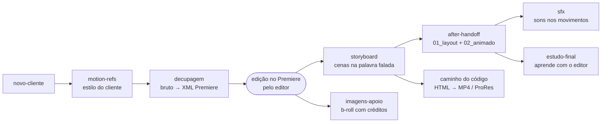

# Studio-IOx · motion-studio

**Um estúdio de motion design e edição que trabalha junto com o [Claude Code](https://claude.com/claude-code).**
Do material bruto multicâmera até o After Effects: decupagem para o Premiere, storyboard das animações aprovado
cena a cena, projetos do After já diagramados e animados, imagens de apoio, efeitos sonoros e renders em código
(HTML → MP4 / ProRes 4444) — sempre no estilo de cada cliente, que o sistema aprende e registra.

> *English summary:* a Claude Code workspace (skills + Python/Node tools) that takes a multicam talking-head
> recording to a synced, cut, camera-switched Premiere XML, plans the motion graphics on the final edit's spoken
> words, and generates After Effects projects (layout + animated) or code-rendered video in each client's brand.
> Windows-first; docs and skills are mixed Portuguese / English.

Você conversa com o Claude em português; ele roda as ferramentas **no seu PC** e mostra o resultado para você
aprovar. O trabalho pesado (sincronizar áudio, transcrever, medir, renderizar) roda localmente; o Claude só lê
resumos compactos — por isso um episódio longo custa por volta de US$ 10 de uso (veja [Custos](#custos)).

---

## O que ele faz



| Etapa | Skill | Entra | Sai |
|---|---|---|---|
| 1 | `novo-cliente` | pasta do cliente, fontes, logos | `client.json`, `STYLE.md`, pasta do episódio |
| 2 | `motion-refs` | 3–6 vídeos do canal (arquivo ou link) | bíblia de estilo (`STYLE.md`) e tokens (`client.json`) |
| 3 | `decupagem` | bruto das câmeras + gravação de tela | XML do Premiere sincronizado, cortado, com troca de câmera e marcas `REVER` |
| 4 | *(editor)* | XML da decupagem | XML final + MP4 leve |
| 5 | `storyboard` | XML final + MP4 | página de revisão cena a cena, `motion_map.json`, lista de assets |
| 5b | `imagens-apoio` | roteiro + XML final | clipes licenciados em `APOIO/`, `CREDITOS.md`, XML com marcas |
| 6 | `after-handoff` | `motion_map.json` | `01_layout.aep` (sem keyframes) e `02_animado.aep` (câmera 3D), conferidos por frames |
| 6b | `sfx` | eventos de motion + biblioteca de SFX | plano de sons e XML com os efeitos em faixas novas |
| 7 | `estudo-final` | `.aep` + `.prproj` finais do editor | `ANALISE.md` e lições gravadas no estilo do cliente |

O **Arsenal** (`Arsenal.bat` ou `python tools/studio.py arsenal --serve`) abre um painel local com todas as
skills, o estado de cada episódio e o próximo pedido já escrito para colar no Claude.

Guia completo de uso, passo a passo e problemas comuns: **[GUIA.md](GUIA.md)**.
Regras que o Claude segue neste projeto: [CLAUDE.md](CLAUDE.md).

---

## Requisitos

### Obrigatórios
| O quê | Versão | Para quê |
|---|---|---|
| **Windows 10 ou 11** | — | o instalador, a ponte com o After (`ae_run.ps1`) e os caminhos foram feitos e testados no Windows |
| **Claude Code** (app desktop do Claude, aba *Code*, ou o CLI) | atual | quem conduz cada etapa; precisa de uma conta Claude com acesso ao Claude Code (plano Pro ou superior) |
| **Python** | 3.11 ou mais novo (testado no 3.14) | decupagem, transcrição, análise de áudio, SFX, imagens de apoio |
| **Node.js** | 20 ou mais novo (testado no 24) | renderer (`render.mjs`, Playwright + Chromium), skills de terceiros |
| **ffmpeg / ffprobe** | 6 ou mais novo, no PATH | todo corte, sincronia e render |
| **Git** | qualquer recente | atualizar o sistema |

### Para as etapas de Adobe
| O quê | Observação |
|---|---|
| **Adobe Premiere Pro** | importa o XML (FCP 7 XML) da decupagem e exporta o XML final |
| **Adobe After Effects** | testado no 2026; precisa estar aberto *com janela* quando o Claude monta o projeto |

Sem a Adobe você ainda usa: decupagem (é um FCP 7 XML, que o DaVinci Resolve também importa; não testado lá),
storyboard, imagens de apoio, SFX e o caminho do código (MP4 / ProRes direto do HTML).

### Recomendados / opcionais
| O quê | Sem ele |
|---|---|
| **Placa NVIDIA** (driver atualizado; ~6 GB de VRAM para o Whisper `large-v3`) | a transcrição roda na CPU, várias vezes mais lenta (`MOTION_STUDIO_WHISPER_DEVICE=cpu` força a CPU) |
| Chaves de API **Pexels**, **Pixabay** (grátis) e **Magnific** (pago) | essa fonte de imagens de apoio é pulada |
| Uma **biblioteca de SFX** sua (pasta local) | o plano de SFX fica mudo; o caminho do código sintetiza sons |
| `yt-dlp` (vem no `requirements.txt`) + node/deno no PATH | baixe os vídeos de referência à mão |

Espaço em disco: ~5 GB (modelos do Whisper, Chromium, pacotes CUDA) além do material dos clientes.

---

## Instalação

```powershell
git clone https://github.com/MayconDouglasg/Studio-IOx.git C:\motion-studio
cd C:\motion-studio
powershell -ExecutionPolicy Bypass -File install.ps1
```

O instalador (pode rodar de novo para atualizar):
1. instala com `winget` o que faltar: Python, Node.js LTS, Git, ffmpeg;
2. instala os pacotes Python (`requirements.txt`) e Node (`package.json`) e o Chromium do Playwright;
3. baixa as skills de terceiros (Remotion, HyperFrames) nas versões fixadas em `skills-lock.json` e liga-as ao Claude Code;
4. cria o `studio.config.json` deste PC (caminho do After Effects, clientes) — nunca vai para o git;
5. roda o diagnóstico. Todas as linhas devem dizer `[OK]` (`[--]` é opcional).

Instalação manual (outro sistema, ou sem winget):
```powershell
python -m pip install --user -r requirements.txt
npm install
npx playwright install chromium
npx skills experimental_install --agent claude-code
python tools/studio.py doctor
```

Depois: abra a pasta no app do Claude (aba **Code** → abrir pasta) ou rode `claude` dentro dela.

## Primeiros passos

1. **Cliente**: diga ao Claude *"vamos configurar um cliente novo"* (ou `python tools/studio.py new-client <slug> "<pasta>" --name "Nome"`).
   Cada cliente é uma pasta sua, fora do repositório: `client.json` (cores, fontes, câmeras), `STYLE.md`, `brand/`, `refs/`, `projects/`.
2. **Estilo**: *"baixa estes 5 vídeos do canal do <slug> e atualiza o estilo: <links>"*.
3. **Episódio**: *"episódio novo do <slug>: ep01-nome"* e depois *"decupa o bruto que está em <pasta>"*.
4. Siga as etapas pela tabela acima; cada uma numa **conversa nova** (é o que mantém o custo baixo).

Chaves de API: `python tools/apoio.py chaves` cria `~/.motion-studio/chaves.json` (fora do git). Nunca cole chaves na conversa.

---

## Custos

O custo vem de o Claude reler a conversa a cada passo, não do trabalho em si. Medido em episódios reais:

| Peça | Uso aproximado |
|---|---|
| Episódio longo (decupagem → After) | ~US$ 10 em preço de API, ~20 % do limite de 5 h do plano Pro |
| Reel | ~US$ 7 (US$ 3–3,5 em lote com outros reels do mesmo cliente) |

Regras que seguram isso (em [CLAUDE.md](CLAUDE.md)): uma conversa por etapa, todas as notas do storyboard numa
rodada só, reels em lote, imagens compactas (folha de contato antes de zoom). As APIs de imagem têm os próprios
planos (Pexels e Pixabay são grátis; Magnific limita downloads por dia). Nada aqui usa serviço pago sem você configurar.

---

## Estrutura

```
CLAUDE.md                 regras para o Claude (pipeline, economia, visual, som, render)
GUIA.md                   guia da equipe, em português
.claude/skills/<etapa>/   uma skill por etapa (SKILL.md com bloco `arsenal:`)
tools/                    ferramentas Python / Node / ExtendScript que as skills rodam
  studio.py               configuração deste PC, clientes, episódios, doctor, arsenal
  decup.py, decup_stage2.py   decupagem (sync, Whisper, corte, XML)
  build_ae.py, ae_*.jsx   geração e conferência dos projetos do After
  codigo.py, render.mjs   caminho do código (HTML → MP4 / ProRes 4444)
  apoio.py, sfx.py        imagens de apoio e efeitos sonoros
  selfcheck.py            checagem do repositório (roda no CI)
starters/                 modelos de cena em código
clients/_template/        modelo neutro de client.json e STYLE.md
arsenal/                  catálogo de receitas, ferramentas e skills externas
skills-lock.json          versões fixadas das skills de terceiros
```

### Dados dos clientes ficam fora
Vídeos, projetos, `STYLE.md` e `client.json` de clientes **nunca** entram no repositório: cada cliente é uma
pasta registrada no `studio.config.json` de cada PC. O repositório só guarda regras gerais e padrões neutros;
`python tools/selfcheck.py` acusa qualquer nome de cliente deste PC que apareça num arquivo versionado.

## Limitações conhecidas
- Feito e testado no **Windows**. macOS / Linux: decupagem, storyboard, SFX e o caminho do código devem rodar com
  instalação manual, mas a ponte com o After (`ae_run.ps1`) é só Windows. Ajuda é bem-vinda.
- As skills misturam inglês (instruções para o Claude) e português (pedidos e guia).
- A qualidade da transcrição depende do idioma: as listas de alucinações do Whisper cobrem pt / en / es.

## Contribuir
Leia [CONTRIBUTING.md](CONTRIBUTING.md). Em resumo: um ramo por melhoria, nada de cliente no código,
`python tools/selfcheck.py` passando, e toda skill nova com o bloco `arsenal:`. O que está planejado: [ROADMAP.md](ROADMAP.md).

## Licença
[MIT](LICENSE): use, modifique e use comercialmente à vontade, mantendo o aviso de copyright. As skills de terceiros instaladas pelo
`skills-lock.json` (Remotion, HyperFrames) não fazem parte deste repositório e seguem as licenças dos seus autores;
as fontes em `fonts/` (Archivo, JetBrains Mono) são SIL Open Font License 1.1.
